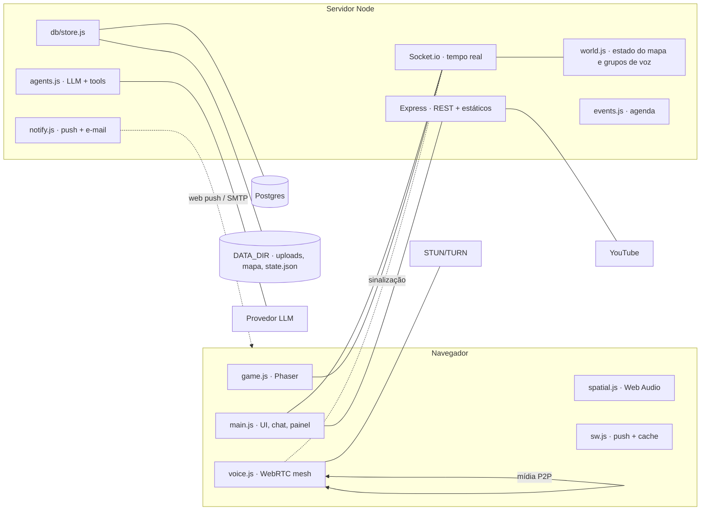

# 2. Arquitetura

## Visão de alto nível

Um único processo Node serve tudo: a API, os arquivos do cliente (build do Vite em `client/dist`), o Socket.io e os uploads. O navegador carrega o app, faz login por cookie, abre o socket e, a partir daí, movimento, chat, presença e sinalização de voz passam pelo socket. A mídia (voz, câmera, tela) nunca passa pelo servidor: vai direto entre navegadores por WebRTC, com STUN/TURN só pra atravessar NAT.

## Cliente

Três páginas, um build (`client/vite.config.js`):

| Página | Entrada | Bundle |
|---|---|---|
| `/` espaço | `client/index.html` → `src/main.js` | `main` (~120 KB) + `game` + `phaser` (1,5 MB, carregado depois em segundo plano) |
| `/admin` painel | `client/admin.html` → `src/admin.js` | `admin` |
| `/membros` biblioteca | `client/membros.html` → `src/membros.js` | `membros` |

Módulos do espaço:

| Módulo | Responsabilidade |
|---|---|
| `main.js` | login (conta/visitante, checagem de mic), boot, sidebar, chat, objetos, caixa de som, agenda, moderação, configurações, tour, mobile |
| `game.js` | cena Phaser: tilemap, profundidade de móveis, avatares locais/remotos, movimento com colisão e deslize em cantos, sentar, NPCs, zonas, marcadores |
| `sprites.js` | pinta o personagem base (64×64, 4 direções) conforme pele, cabelo, roupa, calça, sapato, acessório; corpo Orc premium |
| `voice.js` | uma `RTCPeerConnection` por peer, perfect negotiation, watchdog de reconexão, porta de ruído, dispositivos, câmera e tela |
| `spatial.js` | grafo Web Audio: ganho e pan por distância pra voz e emissores de som ambiente sintetizados |
| `speaker.js` | player YouTube (IFrame API) sincronizado pelo `startedAt` do servidor, volume por distância |
| `tiles.js` | janelas de vídeo arrastáveis e redimensionáveis |
| `settings.js`, `push.js`, `tour.js`, `mobile.js`, `sounds.js`, `icons.js`, `md.js` | configurações de dispositivos, assinatura push, tour, joystick e gavetas, sons sintetizados, ícones SVG, markdown seguro |

## Servidor

| Módulo | Responsabilidade |
|---|---|
| `index.js` | Express + Socket.io: middlewares de segurança, rotas REST, handlers de socket, relógio da agenda, scheduler dos agentes |
| `world.js` | estado dos jogadores e NPCs, grid de colisão, zonas, cálculo dos grupos de voz |
| `map.js` | lê o Tiled (`sede.json`), extrai zonas, objetos, decoração, NPCs, paredes |
| `auth.js` | contas (scrypt), sessões por cookie assinado (HMAC), cargos, versão de sessão |
| `security.js` | cabeçalhos, rate limit, checagem de origem, validadores, bloqueio de SSRF |
| `library.js` | conteúdos, progresso, uploads em disco |
| `agents.js` | provedores OpenAI-compatíveis, tools (web_search, fetch_url, rss), agenda de posts |
| `events.js` | agenda: CRUD + relógio (lembrete, início) |
| `notify.js` | Web Push (VAPID) e e-mail (SMTP) |
| `speaker.js` | parse de links do YouTube, oEmbed, busca por raspagem, refinamento por LLM, estado das caixas |
| `db/store.js` | duas implementações da mesma interface: Postgres (`DATABASE_URL`) ou memória com `state.json` |

## Tempo real: quem ouve quem

A cada movimento o servidor recalcula o grupo de voz de cada pessoa, nesta ordem: canal de voz da sidebar; sala `meeting`; Auditório (`stage`, só quem está no palco fala); zona `silent` (sem voz); área aberta agrupa por proximidade transitiva (raio `proximityRadius`, padrão 3,2 tiles). O cliente recebe `voice:group` com a lista de peers e abre/fecha conexões pra bater com ela. Dentro do grupo, o áudio espacial ajusta volume e lado; em sala ou canal, todo mundo no mesmo volume.

O lado com id menor inicia a oferta (evita colisão na abertura). Um watchdog recria a conexão se ela ficar parada; na segunda falha avisa a pessoa e tenta pelo relay.

## Catálogo de eventos do socket

Cliente → servidor:

| Evento | Payload | Quem | Notas |
|---|---|---|---|
| `join` | `{name, userId, color, avatar, pos}` | todos | cookie de sessão tem prioridade; devolve mapa, canais, jogadores, ICE, caixas, agenda, chave push, silêncio |
| `move` | `{x, y, dir, moving, running}` | todos | servidor valida colisão, trancas e anti-teleporte (2,5 tiles); 40/s |
| `teleport` | `{x, y}` | todos | clique numa sala da sidebar |
| `profile` | `{status, muted, presence, avatar}` | todos | avatar é saneado; silêncio forçado não pode ser desligado |
| `speaking` | `bool` | todos | indicador de fala |
| `chat:send` / `chat:history` | `{channelId, body}` | todos | `zone:<id>` é o chat da sala; #anúncios só equipe; 5 a cada 3 s |
| `bubble` | `{text}` | todos | balão sobre o avatar |
| `voice:channel` | `{channelId}` | todos | entra/sai de canal de voz |
| `rtc:signal` | `{to, data}` | todos | relé de sinalização WebRTC |
| `board:get` / `board:set` | `{id, content}` | todos | quadros compartilhados |
| `agent:chat` / `agent:history` | `{agentId, text}` | todos | precisa estar a 3 tiles do agente; 6/min |
| `object:set` | `{id, url, label}` | equipe | telão e links; YouTube vira embed |
| `speaker:get` / `speaker:set` / `speaker:stop` / `speaker:search` | `{id, url, q}` | todos | caixa de som da sala; stop só quem colocou ou equipe |
| `mod:action` | `{targetId, action, minutes, reason}` | equipe | `mute`, `unmute`, `kick`, `ban` |
| `visibility` | `bool` | todos | aba visível (menção vira push quando não está) |

Servidor → cliente: `state` (12×/s, snapshot dos jogadores), `npcs`, `voice:group`, `chat:message`, `system`, `toast`, `bubble`, `rtc:signal`, `board:update`, `object:update`, `speaker:update`, `world:changed`, `events:changed`, `event:soon`, `event:started`, `mod:muted`, `kicked`, `agent:tool`.

## Catálogo REST

| Método e rota | Acesso | Função |
|---|---|---|
| `GET /api/health` | público | `{ok, online}` |
| `GET /api/map`, `GET /api/channels`, `GET /api/events` | público | mapa atual, canais, agenda |
| `GET /api/auth/config`, `GET /api/auth/me` | público | flags de login; sessão atual |
| `POST /api/auth/login`, `POST /api/auth/register`, `POST /api/auth/logout` | público (12 por 10 min por IP) | sessão por cookie `sede_session` |
| `PUT /api/auth/prefs`, `POST /api/auth/avatar` | conta | lembretes, tour, upload de avatar |
| `GET /api/push/key`, `POST /api/push/subscribe`, `POST /api/push/unsubscribe` | conta | Web Push |
| `GET /api/library`, `POST /api/library/:id/done`, `GET /files/:name` | conta | biblioteca e arquivos hospedados |
| `GET/POST/DELETE /api/admin/content`, `POST/DELETE /api/admin/uploads` | equipe | conteúdos e uploads |
| `GET/POST/DELETE /api/admin/events` | equipe | agenda |
| `GET /api/admin/moderation`, `DELETE /api/admin/bans/:id` | equipe | registro e banidos |
| `GET /api/admin/overview`, `PUT /api/admin/settings` | admin | painel |
| `GET/POST/PUT/DELETE /api/admin/users` | admin | contas |
| `GET/POST/DELETE /api/admin/providers`, `POST /api/admin/providers/:id/test` | admin | provedores LLM |
| `GET/POST/DELETE /api/admin/agents`, `POST …/test`, `POST …/run-schedule` | admin | agentes |
| `PUT /api/admin/world`, `POST /api/admin/map` | admin | trancas, posições, bichos; mapa do Tiled (8 MB) |

Todas as rotas de escrita passam por rate limit geral (600/min por IP), checagem de origem (CSRF) e limite de corpo (1 MB, salvo mapa e uploads).

## Fluxos principais

**Entrar.** `GET /api/auth/me` → login (cookie) ou visitante → `join` pelo socket → ack com o mundo inteiro → Phaser monta a cena → `voice:group` inicial. O Phaser é carregado antes do `join` pra não perder o primeiro `voice:group`.

**Aula ao vivo.** Equipe cria o evento no painel → relógio (10 s) → 15 min antes: push, e-mail, `event:soon` → na hora: link vai pro override do telão, `object:update`, `event:started`, push pra quem está fora.

**Caixa de som.** Alguém aperta E → cola link ou descreve → `speaker:search` (LLM refina, raspagem do YouTube) → `speaker:set` grava `{videoId, startedAt}` → todo mundo na sala recebe `speaker:update` → cada cliente carrega a IFrame API e busca o tempo `now - startedAt`; ressincroniza a cada 6 s se desviar mais de 3 s.
