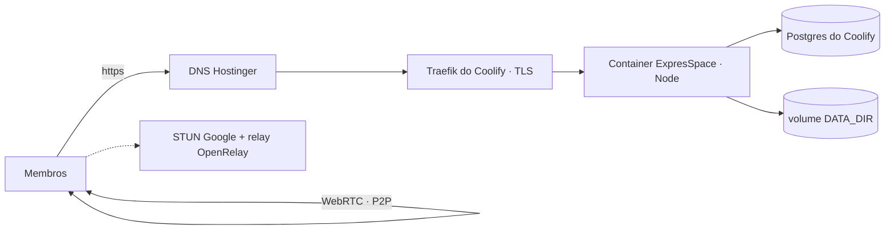
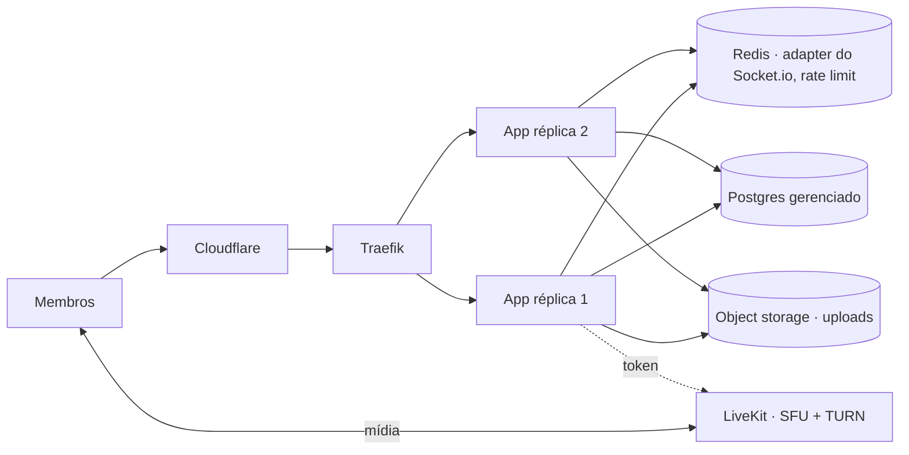

# 5. Infraestrutura

## O que está no ar hoje

Uma VPS Hostinger (`187.77.61.47`) com Coolify (`painel.improveyourlifedaily.com`). O app é um recurso "Dockerfile" ligado ao repositório `Augus7o027/expresspace`; cada push na branch principal faz build e deploy. O Traefik do Coolify termina TLS e passa WebSocket sem configuração extra. Postgres é um recurso do próprio Coolify. Domínio `expressspace.improveyourlifedaily.com`.

Isso atende bem até algumas dezenas de pessoas simultâneas. Os limites reais são a voz em malha (cada pessoa conecta com cada outra do grupo) e o fato de tudo viver numa máquina só.

## Estágios recomendados

### Estágio 1: fechar o básico (agora, custo quase zero)

O que falta pra produção segura na topologia atual:

| Item | Como |
|---|---|
| Backup do Postgres | Coolify tem backup agendado por recurso: diário, retenção 14 dias, destino S3-compatível (Hostinger Object Storage, Backblaze B2 ou Cloudflare R2). Testar uma restauração |
| Backup do `DATA_DIR` | job diário `tar` do volume pro mesmo bucket (script em [06-operacao.md](06-operacao.md)) |
| Cloudflare na frente | DNS proxied: WAF, proteção DDoS, cache dos assets, rate limit de borda. Ligar "Full (strict)". WebSocket passa |
| TURN próprio | coturn na mesma VPS (portas 3478 udp/tcp e 5349 tls), credenciais em `TURN_URL/USER/PASS`. Resolve voz em rede de empresa e 4G |
| Monitoramento | Sentry no cliente e no servidor (DSN por env), UptimeRobot ou Better Stack batendo em `/api/health` a cada minuto, alerta no WhatsApp/e-mail |
| Staging | segundo recurso no Coolify apontando pra branch `staging`, com Postgres próprio. Deploy em produção só depois do e2e passar |
| CI | GitHub Actions rodando `npm test` (Playwright) a cada PR |

Tamanho da VPS: 2 vCPU e 4 GB bastam pro app e Postgres. O coturn consome banda, não CPU: cada pessoa atrás de relay usa ~100 kbps por peer.

### Estágio 2: crescer com segurança (100 a 500 pessoas)

O gargalo passa a ser a voz. Com 30 pessoas numa aula, cada navegador manteria 29 conexões; o áudio degrada e celulares esquentam. A resposta é um SFU (servidor de mídia): cada pessoa manda um fluxo e recebe os que precisa.

| Mudança | Por quê | O que muda no código |
|---|---|---|
| LiveKit (open source, self-hosted) | voz, câmera, tela e palco um-pra-muitos com gravação; TURN embutido | `voice.js` troca a malha por um cliente LiveKit; o servidor emite tokens por sala (o grupo de voz vira o nome da sala) |
| Uploads em object storage | réplicas não compartilham disco; backup vira nativo | `library.js` grava via S3 SDK e serve por URL assinada |
| Redis | Socket.io entre réplicas (`@socket.io/redis-adapter`), rate limit compartilhado, estado do mundo | `index.js` e `security.js` |
| Postgres gerenciado ou réplica | falha da VPS não leva o banco junto | nada, só `DATABASE_URL` |
| Sessões | continuam stateless (cookie assinado); nada muda | |

Estimativa: LiveKit numa VPS de 4 vCPU/8 GB aguenta centenas de participantes em áudio; vídeo pede mais banda que CPU.

### Estágio 3: várias comunidades ou milhares de pessoas

Multi-tenant (uma instância por comunidade em contêineres separados é o caminho mais simples e mais seguro), Kubernetes ou Nomad no lugar do Coolify, CDN pros assets do mapa, LiveKit Cloud ou cluster próprio, observabilidade completa (traces, métricas, logs centralizados). Não vale desenhar isso antes do estágio 2 estar rodando.

## Variáveis de ambiente

| Variável | Obrigatória | Função |
|---|---|---|
| `PORT` | não (3000) | porta do servidor |
| `CLIENT_ORIGIN` | sim em produção | URL pública com https; define cookie `Secure`, HSTS e a checagem de origem |
| `SESSION_SECRET` | sim | assinatura das sessões; sem ele todo mundo desloga a cada restart |
| `DATABASE_URL` | sim em produção | Postgres; sem ele roda em memória |
| `DATA_DIR` | sim | volume com uploads, mapa enviado e `state.json` |
| `ADMIN_EMAIL`, `ADMIN_PASSWORD`, `ADMIN_NAME` | primeira subida | cria o primeiro admin se não houver nenhum |
| `MAX_UPLOAD_MB` | não (500) | teto de upload na biblioteca |
| `TURN_URL`, `TURN_USER`, `TURN_PASS` | recomendado | relay próprio; várias URLs separadas por vírgula |
| `SMTP_URL`, `MAIL_FROM` | opcional | lembretes de aula por e-mail |
| `VAPID_PUBLIC`, `VAPID_PRIVATE` | opcional | fixar as chaves de push (senão geradas e guardadas no banco) |
| `TZ_DISPLAY` | não (America/Sao_Paulo) | fuso dos textos de lembrete |
| `MAP_FILE` | não | trocar o mapa padrão do build |
| `AGENT_ALLOW_LOCAL` | nunca em produção | libera agentes buscarem localhost (só testes) |

## Domínios e DNS

Um domínio pro app. Se entrar LiveKit ou coturn, subdomínios `turn.` e `live.` apontando direto pra VPS (sem proxy do Cloudflare, porque UDP não passa pelo proxy). Certificados pelo Coolify (Let's Encrypt).

## Custos de referência

Estágio 1: VPS atual + object storage (centavos) + Cloudflare grátis + Sentry grátis. Estágio 2: mais uma VPS pro LiveKit e um Redis pequeno; ordem de R$ 150 a 300 por mês a mais. Números aproximados, variam com o provedor.
